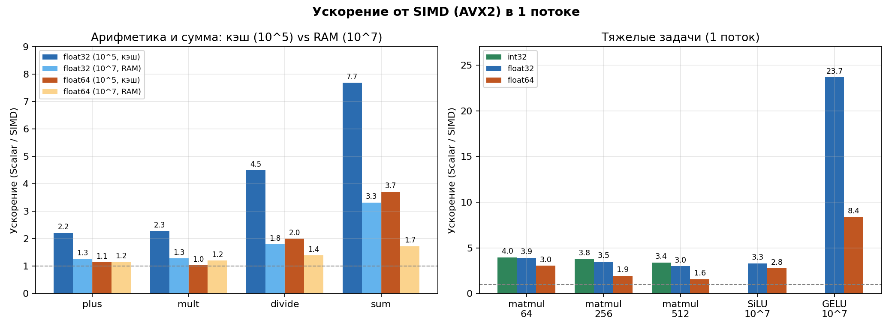
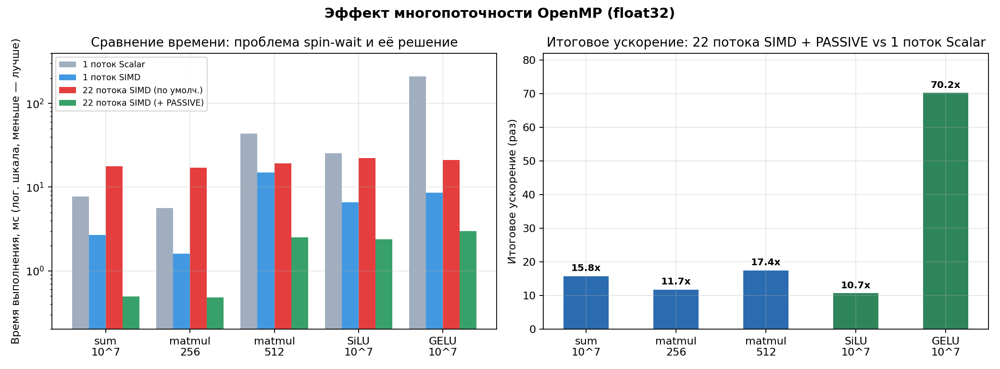

# Отчет по домашнему заданию 1

## Что сделано
Были реализованы в двух вариантах (Scalar и SIMD на AVX2) и для трех типов (int32, float32, float64):

- арифметика над массивами: `+`, `-`, `*`, `/`
- сумма и среднее значение
- функции активации SiLU и GELU (только для float32 и float64)
- умножение квадратных матриц `n x n`.

Все функции параллелизованы через OpenMP, корректность проверяется тестами.

## Как устроен код

Чтобы избежать дублирования, интринсики спрятаны в шаблонной обертке `Simd<T>` (`int`, `float`, `double`) с одинаковым интерфейсом (`load`, `store`, `set1`, `add`, `sub`, `mul`, `div`, `exp`). Ширина регистра `width` равна 8 для `int`/`float` и 4 для `double`.

Каждая операция описана структурой (`Plus`, `Minus`, `Mult`, `Divide`, `SiLU`, `GELU`) с методами `scalar_op` и `simd_op`. Общие шаблоны обхода массивов принимают такую структуру как параметр шаблона, а хвост массива (если размер не кратен `width`) обрабатывается скалярно.

Ключевые детали реализации:
- В AVX2 нет целочисленного деления `int32`: значения переводятся в `double`, делятся и обрезаются через `cvtt` (совпадает с `int / int`).
- Для SiLU и GELU используется SIMD-аппроксимация `exp(x) = 2^n * exp(r)` (ряд Тейлора 6-й степени для `float`, 10-й для `double`; входы ограничены `|80|` и `|700|`). В GELU `tanh(u)` считается как `1 - 2 / (exp(2u) + 1)`.
- В `sum_simd` каждый поток накапливает частичную сумму в собственном SIMD-регистре, после чего они объединяются.

## Тесты на корректность

Скалярная версия служит опорной. SIMD-результат сравнивается со скалярным на массивах длиной `100003` и матрицах `37x37` (не кратны 8 для проверки хвоста). Для `int32` сравнение точное, для `float32` максимальная погрешность `1e-3`, для `float64` это `1e-6`. Максимальная погрешность нужна, так порядок сложения в сумме отличается. Также SIMD экспонента приближенная. Все тесты проходят. 

## Стенд
- Процессор: Intel Core Ultra 7 155H (16 ядер / 22 потока)
- ОС: Windows 11 25H2 / Ubuntu 22.04 LTS (WSL2)
- Компилятор: GCC 11.4.0, C++17
- Флаги: `-O3 -mavx2 -fno-tree-vectorize -fopenmp`
- Параметры запуска OpenMP: `OMP_WAIT_POLICY=PASSIVE OMP_PROC_BIND=close`

---
## Результаты 
Время указано в миллисекундах, ускорение = `Scalar / SIMD`.

### 1. Однопоточный режим (`threads = 1`, среднее по 3 запускам)

#### Арифметика и сумма (1 поток)

| Тип | Операция | `10^3` Sc / SIMD (уск.) | `10^5` Sc / SIMD (уск.) | `10^7` Sc / SIMD (уск.) |
|---|---|---|---|---|
| int32 | plus | 0.0014 / 0.0010 (**1.41x**) | 0.0318 / 0.0143 (**2.23x**) | 6.2648 / 4.9019 (**1.28x**) |
| int32 | minus | 0.0013 / 0.0009 (**1.54x**) | 0.0348 / 0.0179 (**1.94x**) | 6.8249 / 5.0400 (**1.35x**) |
| int32 | mult | 0.0011 / 0.0007 (**1.55x**) | 0.0416 / 0.0185 (**2.24x**) | 6.8684 / 4.9525 (**1.39x**) |
| int32 | divide | 0.0028 / 0.0012 (**2.33x**) | 0.1869 / 0.0628 (**2.98x**) | 18.7994 / 7.4666 (**2.52x**) |
| int32 | sum | 0.0008 / 0.0005 (**1.67x**) | 0.0325 / 0.0046 (**7.01x**) | 4.4778 / 2.2951 (**1.95x**) |
| float32 | plus | 0.0007 / 0.0005 (**1.47x**) | 0.0307 / 0.0139 (**2.21x**) | 6.4202 / 5.0857 (**1.26x**) |
| float32 | minus | 0.0008 / 0.0006 (**1.35x**) | 0.0313 / 0.0151 (**2.07x**) | 6.9505 / 5.1654 (**1.35x**) |
| float32 | mult | 0.0008 / 0.0005 (**1.50x**) | 0.0319 / 0.0140 (**2.28x**) | 7.1740 / 5.6001 (**1.28x**) |
| float32 | divide | 0.0013 / 0.0006 (**2.11x**) | 0.0905 / 0.0201 (**4.50x**) | 9.7732 / 5.4375 (**1.80x**) |
| float32 | sum | 0.0010 / 0.0005 (**2.07x**) | 0.0623 / 0.0081 (**7.69x**) | 7.2145 / 2.1737 (**3.32x**) |
| float64 | plus | 0.0008 / 0.0006 (**1.21x**) | 0.0476 / 0.0419 (**1.14x**) | 11.3679 / 9.7890 (**1.16x**) |
| float64 | minus | 0.0008 / 0.0006 (**1.26x**) | 0.0461 / 0.0435 (**1.06x**) | 11.7765 / 9.9177 (**1.19x**) |
| float64 | mult | 0.0008 / 0.0007 (**1.14x**) | 0.0449 / 0.0437 (**1.03x**) | 11.9168 / 9.9391 (**1.20x**) |
| float64 | divide | 0.0016 / 0.0011 (**1.45x**) | 0.1199 / 0.0601 (**2.00x**) | 13.7713 / 9.8931 (**1.39x**) |
| float64 | sum | 0.0011 / 0.0007 (**1.65x**) | 0.0603 / 0.0162 (**3.71x**) | 7.8298 / 4.5320 (**1.73x**) |

#### Умножение матриц и активации (1 поток)

| Тип | Операция | `64` / `10^3` Sc / SIMD (уск.) | `256` / `10^5` Sc / SIMD (уск.) | `512` / `10^7` Sc / SIMD (уск.) |
|---|---|---|---|---|
| int32 | matmul | 0.1050 / 0.0264 (**3.97x**) | 6.6739 / 1.7692 (**3.77x**) | 50.2761 / 14.7878 (**3.40x**) |
| float32 | matmul | 0.1088 / 0.0278 (**3.92x**) | 5.7239 / 1.6332 (**3.50x**) | 43.6204 / 14.5749 (**2.99x**) |
| float64 | matmul | 0.1449 / 0.0476 (**3.04x**) | 6.5351 / 3.3561 (**1.95x**) | 44.9068 / 28.6762 (**1.57x**) |
| float32 | SiLU | 0.0030 / 0.0010 (**3.03x**) | 0.2445 / 0.0528 (**4.63x**) | 23.2101 / 7.0409 (**3.30x**) |
| float32 | GELU | 0.0159 / 0.0012 (**12.86x**) | 2.0805 / 0.0769 (**27.07x**) | 206.5556 / 8.7234 (**23.68x**) |
| float64 | SiLU | 0.0054 / 0.0020 (**2.73x**) | 0.5009 / 0.1548 (**3.23x**) | 47.0613 / 16.9944 (**2.77x**) |
| float64 | GELU | 0.0139 / 0.0026 (**5.33x**) | 1.9086 / 0.2160 (**8.84x**) | 183.9159 / 21.9665 (**8.37x**) |

---

### 2. Многопоточный режим (threads = 22): 

- **Задачи ниже порога** (`10^3`, `10^5`, `matmul 64` и `+ - * /` на `10^7`) выполняются в 1 поток без вызова OpenMP, поэтому сохраняют однопоточную скорость в обоих режимах (например, `int32 plus 10^3`: `0.0005 мс`, `float32 gelu 10^5`: `0.0909 мс` и т.д.).
- **Задачи выше порога** приведены ниже: сравнение запуска по умолчанию (среднее по 3 запускам) и с флагами `OMP_WAIT_POLICY=PASSIVE OMP_PROC_BIND=close`. Колонка `T1/T22` показывает ускорение от 22 потоков (с флагом) относительно 1 потока того же запуска.

| Тип | Операция (размер) | 1 поток (Sc / SIMD) | 22 потока, по умолч. (Sc / SIMD) | 22 потока + PASSIVE (Sc / SIMD, уск.) | Потоки `T1/T22` (Sc / SIMD) |
|---|---|---|---|---|---|
| int32 | sum (`10^7`) | 3.7826 / 2.0460 | 17.9575 / 16.2022 | **1.0291 / 0.6068** (1.70x) | **3.68x / 3.37x** |
| int32 | matmul (`256`) | 5.6479 / 1.4504 | 15.9410 / 15.4524 | **1.0579 / 0.3896** (2.72x) | **5.34x / 3.72x** |
| int32 | matmul (`512`) | 42.7983 / 13.4081 | 26.8779 / 21.5093 | **7.8015 / 2.2165** (3.52x) | **5.49x / 6.05x** |
| float32 | sum (`10^7`) | 7.7165 / 2.6697 | 20.5182 / 17.6833 | **0.8445 / 0.4940** (1.71x) | **9.14x / 5.40x** |
| float32 | matmul (`256`) | 5.6327 / 1.6023 | 19.0242 / 17.0241 | **1.1766 / 0.4846** (2.43x) | **4.79x / 3.31x** |
| float32 | matmul (`512`) | 43.6143 / 14.9384 | 23.5663 / 19.1564 | **8.1474 / 2.4956** (3.26x) | **5.35x / 5.99x** |
| float32 | SiLU (`10^7`) | 25.3954 / 6.6126 | 25.2475 / 22.3752 | **5.4891 / 2.3830** (2.30x) | **4.63x / 2.77x** |
| float32 | GELU (`10^7`) | 210.6251 / 8.6298 | 44.6385 / 21.2124 | **32.5661 / 2.9979** (10.86x) | **6.47x / 2.88x** |
| float64 | sum (`10^7`) | 8.5329 / 5.0454 | 22.0392 / 18.8080 | **1.6650 / 1.5346** (1.09x) | **5.12x / 3.29x** |
| float64 | matmul (`256`) | 7.0640 / 3.7313 | 20.5577 / 17.7731 | **1.2550 / 0.7418** (1.69x) | **5.63x / 5.03x** |
| float64 | matmul (`512`) | 49.1815 / 31.3034 | 26.9154 / 19.8394 | **9.4150 / 5.7429** (1.64x) | **5.22x / 5.45x** |
| float64 | SiLU (`10^7`) | 48.0691 / 17.1900 | 30.3413 / 28.8119 | **10.5556 / 6.6229** (1.59x) | **4.55x / 2.60x** |
| float64 | GELU (`10^7`) | 193.9306 / 22.4215 | 47.2392 / 23.5233 | **35.1241 / 8.5191** (4.12x) | **5.52x / 2.63x** |

### 3. Графики

## Анализ

- Влияние типа данных: В 256-битный регистр AVX2 помещается 8 чисел `int32`/`float32` и 4 числа `float64`. Поэтому на вычислительно плотных операциях (`sum` в кэше, `matmul`, `SiLU`, `GELU`) `int32` и `float32` ускоряются примерно вдвое сильнее `float64` (`3.4–7.7x` против `1.6–3.7x`).
- Упор в пропускную способность памяти (`10^7`): На арифметических орерациях наибольшее ускорение SIMD приходится на `10^5` элементов (`1.9–2.3x` для `int32`/`float32`, данные в кэше), а на `10^7` падает до `1.2–1.4x`. Массивы суммарным объёмом 120–240 МБ не помещаются в кэш, и скорость ограничивается шиной памяти.
- Тяжёлые операции (`divide`, `sum`, `matmul`, активации): Чем больше вычислений на элемент, тем лучше показывает себя SIMD: в `sum`до `7.7x`, в `GELU` — за счёт замены `std::tanh` на векторную `exp` (до `27x` для `float32` и `9.2x` для `float64`).
- Эффект порогов OpenMP: Введение порогов полностью устранило деградацию на малых и средних задачах (`10^3`, `10^5`, `matmul 64`) и удержало скорость потоковых операций `+ - * /` на `10^7`. Вместо 15–18 мс оверхеда на малых массивах многопоточная версия работает с той же скоростью, что и однопоточная.
- Флаг `OMP_WAIT_POLICY=PASSIVE`: Без флага активное ожидание потоков (`spin-wait`) в WSL2 добавляло ~15 мс на барьер, из-за чего быстрые SIMD-ядра (`sum 10^7`, `matmul 256`, `SiLU 10^7`) на 22 потоках замедлялись относительно 1 потока.
 С `OMP_WAIT_POLICY=PASSIVE OMP_PROC_BIND=close` оверхед исчез, и 22 потока ускорили даже SIMD-реализации в 2.6–6.0x: `matmul 512` снизился с `13.4–14.9 мс` до `2.2–2.5 мс` (`~17–19x` против 1-поточного скаляра), `sum 10^7` для `float32` — до `0.49 мс`, а `GELU 10^7` для `float32` — до `3.00 мс` (то есть суммарно 70x быстрее 1-поточного скаляра).

## Выводы

1. SIMD (AVX2) даёт `2–2.5x` ускорения для `int32`/`float32` на простых операциях в кэше, `1.2–1.4x` на `10^7` (ограничение памяти) и `3–27x` на `divide`, `sum`, `matmul` и функциях активации; на `float64` выигрыш примерно вдвое ниже из-за ширины регистра.
2.Пороги включения OpenMP обязательны, так как они полностью исключают потерю производительности на малых и ограниченных памятью задачах. Они передают в многопоточную обработку только вычислительно тяжёлые вызовы.
3. Сочетание SIMD + OpenMP + `OMP_WAIT_POLICY=PASSIVE` позволяет достичь наилучшей производительности без конфликтов с планировщиком WSL, давая итоговое ускорение относительно 1-поточного скаляра до 15.6x на `sum 10^7`, 19.3x на `matmul 512` и 70.3x на `GELU 10^7`.